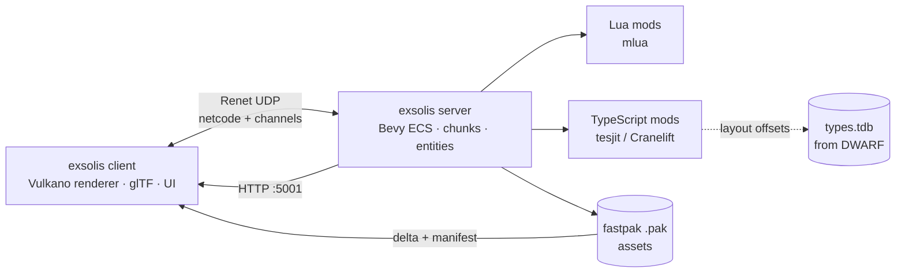

<div align="center">

# exsolis

**A voxel game engine written in Rust — Bevy ECS for the simulation, a hand-rolled Vulkan renderer for the pixels, and two scripting backends for the mods.**

`exsolis` is a Minecraft-flavoured voxel world: infinite streamed chunks, a data-driven block registry, entities with skeletal animation, server-driven UI, and a modding layer that lets you write Lua *or* statically-typed TypeScript against the live ECS.

</div>

---

## Table of contents

- [Highlights](#highlights)
- [Architecture](#architecture)
- [Getting started](#getting-started)
- [Controls](#controls)
- [Modding](#modding)
- [Assets](#assets)
- [Type layout database](#type-layout-database)
- [Development commands](#development-commands)
- [Benchmarks](#benchmarks)
- [Documentation](#documentation)
- [Project layout](#project-layout)

---

## Highlights

| Area | What it does |
|---|---|
| **Voxel world** | 32³ chunks, palette-compressed, streamed in and out around each player with a per-player render distance and vertical layers. |
| **Block registry** | Data-driven, not an enum: names (`exsolis:stone`), ids, solidity, transparency, block entities, placeability, and multi-cell layouts (beds, doors). |
| **Custom renderer** | Not Bevy Render — a Vulkano task-graph pipeline with a sub-allocated vertex/index arena, a three-stage chunk mesher, bindless textures, and a separate UI pass. |
| **glTF + animation** | Hand-written glTF loader with MikkTSpace tangents, joint-space baking, rigid single-influence skinning, and an animation clip layer. |
| **Server-driven UI** | The server sends XML templates; the client parses them into a Bevy UI entity tree and reports clicks back as actions. |
| **Two mod backends** | Lua via `mlua` (hot-reloading, event-driven) *and* TypeScript compiled to native code by a custom Cranelift JIT (`tesjit`). |
| **Typed ECS for mods** | Mods write typed `Query<[Entity, Mut<Position>]>`, `Res<T>` / `Mut<T>` systems and `Commands.spawn` — compiled ahead of time, not reflected at runtime. |
| **Asset delivery** | A memory-mapped `.pak` archive (`fastpak`) with O(1) lookup, per-asset zstd frames, HTTP delta delivery, and hot reload while the server runs. |
| **Real Rust layouts for mods** | A DWARF exporter turns the server binary's debug info into a queryable type database, so mods address genuine Rust structs instead of guessed offsets. |

---

## Architecture



The **server** is the authority: it owns the world, the ECS, inventory, and the mod VMs. The **client** is a thin, state-driven view that renders what it is told and sends back intent. Both link `exsolis_common`, which is the single source of truth for the wire protocol, block ids, chunk packing, and inventory format.

---

## Getting started

### Prerequisites

- **Rust** with edition 2024 support (stable 1.85+)
- **A Vulkan 1.x driver** on the client machine (the renderer uses Vulkano directly)
- [`just`](https://github.com/casey/just) for the recipes below (optional — everything is a plain `cargo` command)

### Run it

```sh
just
```

That launches the server in the background and the client in the foreground. To run the halves separately:

```sh
cargo run --bin exsolis_server_bin   # authoritative world, port 5000
cargo run --bin exsolis               # client window
```

The client connects to `127.0.0.1:5000` by default. Assets are served over HTTP on `0.0.0.0:5001`.

### Environment variables

| Variable | Default | Purpose |
|---|---|---|
| `EXSOLIS_ASSET_DIR` | `assets/` | Server-side asset source directory that gets packed and served. |
| `EXSOLIS_ASSET_BIND_ADDR` | `0.0.0.0:5001` | Address the asset HTTP listener binds to. |
| `EXSOLIS_ASSET_BASE_URL` | `http://<public host>:5001` | Public origin clients download assets from — point it at an HTTPS reverse proxy in production. |
| `EXSOLIS_ASSET_CACHE_DIR` | `~/.exso/downloaded/` | Persistent client-side asset cache (kept outside the repo). |
| `EXSOLIS_MODS_DIR` | `mods/` | Directory the server scans for Lua and TypeScript mods. |
| `EXSOLIS_TYPES_DB` | `./types.tdb` | Exported type layout database the server loads at startup. |

---

## Controls

| Input | Action |
|---|---|
| `W` `A` `S` `D` | Move (the camera is a free-fly camera — no gravity yet) |
| `Space` | Ascend |
| `Ctrl` | Descend |
| Mouse | Look |
| Left click | Break block |
| Right click | Place block |
| `1` – `9` | Select hotbar slot |
| `E` | Toggle inventory (bound by a Lua mod, not the engine) |

Keybinds are a first-class, server-driven concept: mods register them with an id, a default key, a description, and a category, and clients may remap them locally.

---

## Modding

Mods live in `mods/` and are hot-reloaded — edit a file and the server picks up the new version on the next tick. A Lua mod that fails to load is skipped with a log line; a TypeScript mod that fails to recompile keeps its last good build. A bug in one mod never takes the server down.

Two backends run side by side, and both push the same request shape through the same translator:

### Lua — `mods/**/*.lua`

Event-driven, dynamic, and the fastest way to change gameplay. The server exposes an explicit `api.*` surface; a mod never touches the ECS directly.

```lua
api.on("player_join", function(ev)
    api.register_keybind({
        player_id = ev.player_id,
        id = "inv:toggle",
        key = "KeyE",
        description = "Toggle Inventory",
        category = "Inventory",
    })
end)

api.on("keybind", function(ev)
    if ev.id == "inv:toggle" and ev.pressed then
        local xml = api.render_xml("inventory", inv_data(ev.player_id))
        api.send(ev.player_id, "ui_show", "inv", xml)
    end
end)
```

Highlights: `api.on(...)` / `api.on_tick(...)`, `api.send` / `api.broadcast` / `api.broadcast_action`, `api.set_block` / `api.get_block`, `api.get_player_pos`, `api.get_inventory`, `api.register_keybind`, and `api.render_xml` for templated UI.

### TypeScript — `mods/**/*.ts`

Statically typed, compiled to **native machine code** by [`tesjit`](crates/tesjit/README.md), a TypeScript → Cranelift JIT written for this project. Mods get real typed ECS access:

```ts
export function on_tick(
  query: Query<[Entity, Mut<Position>], [With<PlayerTag>, Without<Disabled>]>,
  config: Res<ModConfig>,
): void {
  for (const [entity, position] of query) {
    position.x += config.speed;
  }
}
```

Every function boundary must be annotated (parameters *and* return type). Queries iterate matching Bevy table rows directly and write through to the world with no snapshot or copy-back. The runtime is sandboxed: fuel budgets, bounds-checked memory access, a fixed arena per module, and traps instead of unwinds — one buggy mod can never take the server down.

See [`documentation/scripting/typescript-modding.md`](documentation/scripting/typescript-modding.md) for the full query and `Commands` surface, and [`mods/exsolis.d.ts`](mods/exsolis.d.ts) for the ambient host API.

---

## Assets

The server scans its `assets/` directory, builds a manifest of normalized paths and xxh3-64 checksums, and serves the payload as a [`fastpak`](crates/fastpak) archive:

- **O(1) random access** through an on-disk hash table — reading one asset touches only that asset's bytes.
- **Per-asset zstd frames**, so a random access never has to decode its neighbours.
- **Extension-grouped layout**, so all `.ktx2` files are one contiguous range.
- **Overlay merges**, so a hot-reload delta is copied rather than recompressed.

Clients keep a persistent cache outside the repository, compare it against the server manifest on join, and download only what is missing or changed. Asset bytes travel over HTTP only — never over the UDP game channel. While the server runs it polls asset metadata and pushes small deltas to connected clients.

Details, including HTTPS reverse-proxy setup, are in [`documentation/assets.md`](documentation/assets.md).

---

## Type layout database

Mods need to address real Rust structures, and `rustc` reorders fields and inserts padding. [`tesjit-dwarf`](crates/tesjit-dwarf/README.md) reads the DWARF debug info out of the server binary and exports a versioned `types.tdb` describing every struct's true layout:

```sh
just export-types
```

The server loads `types.tdb` at startup, and the mod runtime cross-checks its registered layouts against it — a layout change on the Rust side becomes an error instead of a silent misread.

---

## Development commands

| Command | What it does |
|---|---|
| `just` | Run the server and the client together. |
| `just export-types` | Rebuild the server with full debug info and export `types.tdb` from DWARF. |
| `just bench-scripting` | Compare native Rust, Bevy queries, and the TypeScript JIT on one identical workload. |
| `cargo test -p tesjit` | JIT compiler, sandbox, and diagnostics tests. |
| `cargo test --bin exsolis_server_bin` | Server-side tests. |
| `cargo check --workspace` | Fast type-check of everything. |

---

## Benchmarks

The scripting layer is benchmarked against a native Rust column loop on one workload: 10k entities, `x += v * dt` per step (`crates/tesjit/benches/scripting.rs`).

| Approach | ns / entity / step | × vs raw |
|---|---:|---:|
| Raw Rust over column slices | 0.84 | 1.00 |
| Cranelift kernel over column pointers | 0.84 | 1.00 |
| Native Bevy query | 1.65 | 1.96 |
| Bevy dynamic `FilteredEntityMut` | 18.22 | 21.7 |

The JIT matches a hand-written unsafe Rust loop byte for byte, so codegen is not the bottleneck — which is why the typed-query design (compile-time layout knowledge instead of runtime reflection) is viable at all.

---

## Documentation

Full documentation lives in **[`documentation/`](documentation/)** — start with its [index](documentation/README.md).

| Document | Contents |
|---|---|
| [`documentation/architecture.md`](documentation/architecture.md) | The crates, their responsibilities, and how data flows between them. |
| [`documentation/world-and-blocks.md`](documentation/world-and-blocks.md) | Chunks, streaming, the block registry, world generation, the authoritative inventory. |
| [`documentation/networking.md`](documentation/networking.md) | The Renet transport, the two channels, and every message on the wire. |
| [`documentation/rendering.md`](documentation/rendering.md) | The Vulkano pipeline, chunk meshing, the glTF loader. |
| [`documentation/entities-and-animation.md`](documentation/entities-and-animation.md) | The entity registry, entity kinds, animation. |
| [`documentation/scripting/typescript-modding.md`](documentation/scripting/typescript-modding.md) | **Writing a TypeScript mod** — the language subset, the host API, typed ECS queries. |
| [`documentation/scripting/typescript-runtime.md`](documentation/scripting/typescript-runtime.md) | **How the TypeScript runtime works** — the compiler pipeline, the sandbox, the DWARF type database. |
| [`documentation/lua-modding.md`](documentation/lua-modding.md) | The Lua `api.*` surface and the event list. |
| [`documentation/ui/xml-ui.md`](documentation/ui/xml-ui.md) | **Writing an XML UI** — the tag vocabulary, the template language, actions. |
| [`documentation/ui/xml-ui-internals.md`](documentation/ui/xml-ui-internals.md) | **How the XML UI works** — the server renderer, the client parser, the round trip. |
| [`documentation/assets.md`](documentation/assets.md) | Asset delivery, the `.pak` format, caching, hot reload. |
| [`documentation/mod-effects.md`](documentation/mod-effects.md) | Server-authored visual effects: action routing, WGSL packages, instance pooling. |
| [`documentation/build-and-tooling.md`](documentation/build-and-tooling.md) | Build profiles, the `just` recipes, the export toolchain, the benchmarks. |
| [`crates/tesjit/README.md`](crates/tesjit/README.md) | The TypeScript → Cranelift JIT crate: language rules, embedding, sandbox. |
| [`crates/tesjit-dwarf/README.md`](crates/tesjit-dwarf/README.md) | The DWARF type-layout exporter crate. |
| [`crates/bbmodel_rs/README.md`](crates/bbmodel_rs/README.md) | The Blockbench `.bbmodel` model loading and animation-summaries crate. |

---

## Project layout

```
exsolis/
├── common/          Shared protocol, block registry, chunk packing, inventory
├── server/          Authoritative simulation: chunks, entities, inventory, mods, assets
├── client/          Vulkano renderer, glTF loader, animation, server-driven UI
├── crates/
│   ├── bbmodel_rs/ Blockbench .bbmodel loading + animation summaries
│   ├── fastpak/     Memory-mapped asset archive (.pak)
│   ├── tesjit/      Statically-typed TypeScript → Cranelift JIT
│   ├── tesjit-dwarf/DWARF → type layout database (types.tdb)
│   └── tesjit-schema/  Shared schema for the type database
├── mods/            Lua and TypeScript mods (hot-reloaded)
├── assets/          Textures, models, UI XML templates
├── examples/        Standalone mod packages
└── documentation/   Guides, references and design plans
```

---

<div align="center">
<em>Built with Bevy ECS, Vulkano, Cranelift, mlua, and a lot of stubbornness.</em>
</div>
